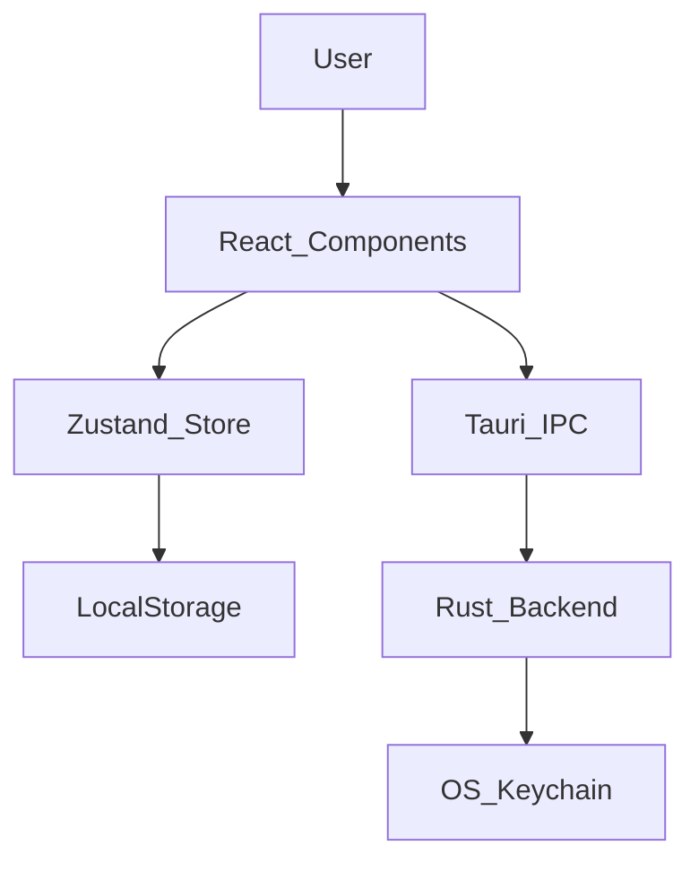
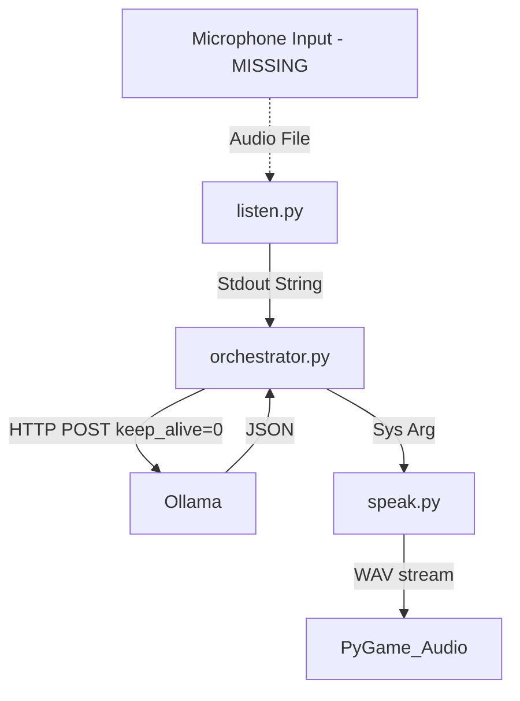
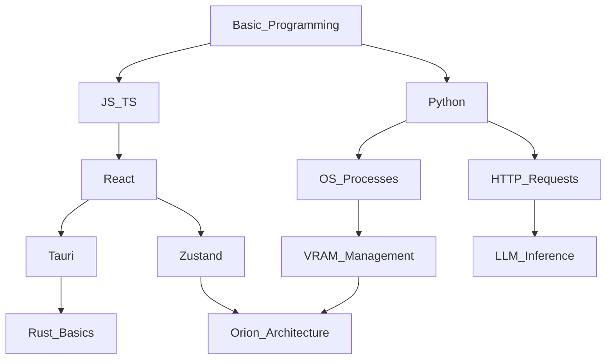

# ORION MASTER BOOK ANALYSIS

## FOREWORD TO CLAUDE OPUS
This is the foundational specification and forensic analysis for the **Orion Textbook Project**. Your mandate is to use this document to write an exhaustive, beginner-friendly university-level textbook that will take a complete beginner from absolute zero to successfully reconstructing the Orion Workspace independently. Do not optimize for brevity. Optimize for deep understanding, reasoning, and systems engineering.

---

## PHASE 1 — COMPLETE PROJECT INVENTORY

**Project Structure Overview (FACT):**
```
ORION/
├── backend/ (Python AI CLI)
├── data/ (Qdrant vector DB)
└── orion-ui/ (React/Tauri Frontend)
```

**Significant Files:**

1. `backend/orchestrator.py`
* **PURPOSE:** Master AI process controller.
* **LANGUAGE:** Python.
* **DEPENDENCIES:** `subprocess`, `requests`.
* **EXPORTED FUNCTIONS:** `hear()`, `think()`, `speak()`, `main()`.
* **SIDE EFFECTS:** Spawns/kills processes, manipulates GPU memory (VRAM).
* **INPUT/OUTPUT:** stdout text parsing, HTTP JSON requests.
* **CURRENT STATUS:** Active (CLI only).
* **LEARNING IMPORTANCE:** Extremely High (Systems architecture, VRAM constraints).

2. `backend/listen.py`
* **PURPOSE:** Speech-to-text via Whisper.
* **LANGUAGE:** Python.
* **DEPENDENCIES:** `faster-whisper`.
* **INPUT:** Audio file path (sys.argv[1]).
* **OUTPUT:** stdout `TRANSCRIPT:<text>`.
* **RESOURCE USAGE:** Max GPU VRAM during execution, instantly freed on exit.
* **CURRENT STATUS:** Active, but fundamentally broken (no mic logic).
* **LEARNING IMPORTANCE:** High (Subprocess IPC, Whisper).

3. `backend/speak.py`
* **PURPOSE:** Text-to-speech via Kokoro.
* **LANGUAGE:** Python.
* **DEPENDENCIES:** `pygame`, `soundfile`, `kokoro`.
* **INPUT:** Text string (sys.argv[1:]).
* **OUTPUT:** Audio playback (speakers).
* **CURRENT STATUS:** Active.
* **LEARNING IMPORTANCE:** High (Audio generation, offline TTS).

4. `orion-ui/src/store/useOrionStore.ts`
* **PURPOSE:** Global state management for the entire React app.
* **LANGUAGE:** TypeScript.
* **DEPENDENCIES:** `zustand`, `uuid`.
* **DATA STRUCTURES:** Arrays of objects (Tasks, Projects, Quizzes, Flashcards, etc.).
* **SIDE EFFECTS:** Persists to `localStorage`.
* **CURRENT STATUS:** Active, highly developed.
* **LEARNING IMPORTANCE:** Critical (State management, local persistence).

5. `orion-ui/src-tauri/src/lib.rs`
* **PURPOSE:** Native OS integration.
* **LANGUAGE:** Rust.
* **DEPENDENCIES:** `keyring`, `tauri`.
* **EXPORTED FUNCTIONS:** `save_api_credential`, `check_api_credential`.
* **SIDE EFFECTS:** Writes to OS secure enclave.
* **CURRENT STATUS:** Active.
* **LEARNING IMPORTANCE:** High (Desktop security, IPC, Rust basics).

*(Note: Minor UI components are summarized into domain boundaries. E.g., `PomodoroModule.tsx` handles timer state locally).*

---

## PHASE 2 — DEPENDENCY ANALYSIS

**Frontend (React/Tauri) Dependency Graph (FACT):**
`App.tsx` -> `AppShell.tsx` -> `Sidebar.tsx` & `CommandPalette.tsx` & `<Outlet/>` -> Domain Modules (e.g., `TodayModule.tsx`).
All modules -> `useOrionStore.ts` -> `zustand` -> `localStorage`.
`SettingsModule.tsx` -> `@tauri-apps/api/core` (invoke) -> `src-tauri/src/lib.rs` -> `keyring` crate.

**Backend Dependency Graph (FACT):**
`main.py` -> `orchestrator.py`
`orchestrator.py` -> (subprocess) -> `listen.py` -> `faster-whisper`
`orchestrator.py` -> (HTTP POST) -> `localhost:11434` (Ollama)
`orchestrator.py` -> (subprocess) -> `speak.py` -> `kokoro` & `pygame`

**Disconnected Code (FACT):**
* `backend/documents.py`: Relies on `mem0`, `PyMuPDF`. Never imported by orchestrator. Dead code/experimental.
* `backend/memory.py`: Never imported by orchestrator.

---

## PHASE 3 — ARCHITECTURE RECONSTRUCTION

**The Disconnected Monolith (FACT):**
There is no unified architecture. There are two completely separated architectures running in the same repository.

**Architecture A: The UI (Current State)**


**Architecture B: The AI (Current State)**


**Missing Connection (INFERENCE/INTENTION):**
The original intent was likely to have Tauri spawn the Python backend as a sidecar process and communicate via WebSockets or stdout/stdin IPC, but this was never implemented.

---

## PHASE 4 — HISTORICAL / GIT ANALYSIS

*Note: The AI backend lacks evolutionary history. It was committed entirely in `e9ee6ae`.*

**DATE:** Day 1
**COMMIT:** `e9ee6ae`
**CHANGE:** The entire Python backend dropped into repo.
**WHY (INFERENCE):** Developer built the AI pipeline out-of-band to solve hardware constraints before integrating into a UI.
**CONFIDENCE:** FACT (commit exists), INFERENCE (motivation).

**DATE:** Day X
**COMMIT:** `45785e6`
**CHANGE:** GlobalSearch replaced with CommandPalette.
**WHY (FACT):** To harden the command center and introduce a mode-aware command system rather than simple search.
**CONFIDENCE:** FACT.

**DATE:** Day X+1
**COMMIT:** `790094e`
**CHANGE:** Expansion to 15+ workspaces (StudyAnalytics, CitationManager, etc.).
**WHY (INTENTION):** To transform Orion from a basic task manager into a comprehensive personal OS.
**CONFIDENCE:** FACT (code change), INFERENCE (strategic intent).

---

## PHASE 5 — RECONSTRUCT THE ENGINEERING STORY

**The GPU/VRAM Problem:**
**PROBLEM:** Loading Gemma, Whisper, and Kokoro simultaneously crashes an 8GB/12GB consumer GPU (Out Of Memory).
**INITIAL APPROACH:** Unknown (lost to Git history).
**NEW APPROACH (FACT):** Strict Sequential VRAM Eviction.
**TRADE-OFF (FACT):** Absolute VRAM safety at the cost of massive latency (5-15s per conversation turn) due to cold-booting models from disk to RAM to VRAM repeatedly.
**CURRENT STATE:** Operational CLI with high latency.

**The UI Scaling Problem:**
**PROBLEM:** Putting all business logic (date parsing, overdue checks) directly in React components made them huge and brittle.
**NEW APPROACH (FACT):** Extracting pure selectors (`src/domain/today/selectors.ts`).
**TRADE-OFF (FACT):** More boilerplate files, but highly testable logic (evidenced by `selectors.test.ts`).

---

## PHASE 6 — LOCAL AI FORENSICS

**WHISPER:**
* MODEL: large-v3-turbo
* FORMAT: CTranslate2 (inferred from faster-whisper default).
* RUNTIME: `faster-whisper`.
* DEVICE: CUDA.
* LOAD METHOD: Subprocess Python initialization.
* UNLOAD METHOD: Subprocess `sys.exit()`.
* CURRENT STATUS: Active, but missing physical mic recording logic.

**GEMMA:**
* MODEL: gemma4:e4b (Ollama quant).
* RUNTIME: Ollama.
* DEVICE: CUDA.
* LOAD METHOD: HTTP POST request.
* UNLOAD METHOD: `"keep_alive": 0` flag in JSON payload.
* CURRENT STATUS: Active.

**KOKORO:**
* MODEL: af_heart (voice).
* RUNTIME: `KPipeline`.
* DEVICE: CUDA.
* LOAD METHOD: Subprocess Python initialization.
* UNLOAD METHOD: Subprocess `sys.exit()`.
* CURRENT STATUS: Active.

---

## PHASE 7 — VRAM / GPU ENGINEERING

**VRAM Lifecycle (The Eviction Strategy):**

This is the most critical systems engineering concept in the project.

1. **DISK:** Models rest on NVMe/SSD. GPU VRAM is empty (0/8GB).
2. **SYSTEM RAM -> VRAM:** `listen.py` starts. Whisper loads (~3-4GB VRAM).
3. **INFERENCE:** Transcription occurs.
4. **RELEASE:** `listen.py` hits EOF. OS reclaims memory. VRAM is empty (0/8GB).
5. **SYSTEM RAM -> VRAM:** Ollama receives HTTP request. Loads Gemma (~3-5GB VRAM).
6. **INFERENCE:** LLM generates tokens.
7. **RELEASE:** Ollama reads `keep_alive=0` and immediately evicts Gemma. VRAM is empty (0/8GB).
8. **SYSTEM RAM -> VRAM:** `speak.py` starts. Kokoro loads (~2GB VRAM).
9. **INFERENCE:** Audio plays.
10. **RELEASE:** `speak.py` exits. VRAM is empty (0/8GB).

**TRADE-OFF ANALYSIS:**
* **Reliability:** 100%. Impossible to OOM unless a single model exceeds total VRAM.
* **Latency:** Appalling. User waits 5-15 seconds for every reply.
* **Complexity:** High. Requires spinning up Python interpreters wildly.
* **Why it was acceptable:** It is the *only* way to run a multi-modal AI assistant locally on low-end hardware.

---

## PHASE 8 — COMPLETE AUDIO PIPELINE

MICROPHONE -> **[BROKEN LINK: No recording logic exists]** -> AUDIO FILE -> `listen.py` (Subprocess/GPU) -> stdout (Text) -> `orchestrator.py` (String parsing) -> Ollama (HTTP) -> `orchestrator.py` -> `speak.py` (Subprocess/GPU) -> `kokoro` -> `pygame.mixer` -> SPEAKERS.

**ERROR HANDLING:** `orchestrator.py` wraps Ollama HTTP calls in `try/except` for ConnectionError/Timeout. Subprocesses (`listen`/`speak`) have very minimal error handling and print to `stderr`.

---

## PHASE 9 — FRONTEND DEEP ANALYSIS

**Architecture Pattern (FACT):**
Client-side monolith with Zustand acting as a transient local database.

**Component Hierarchy:**
`main.tsx` (React root) -> `App.tsx` (Routing) -> `AppShell.tsx` (Layout) -> `Sidebar` / `CommandPalette` / `Outlet`.

**State Flow:**
One massive Zustand store (`useOrionStore.ts`) holds all domains. Components map over arrays to render. Modifying an item calls a store action (e.g., `updateTask`), which triggers a React re-render and a background save to `localStorage`.

**Flaws (INFERENCE/FACT):**
`localStorage` is synchronous and limited to ~5MB. Storing full rich-text documents (`content: "..."`) in Zustand will eventually freeze the UI thread and crash the browser engine.

---

## PHASE 10 — TAURI / RUST

**IMPLEMENTED:** 
OS Keychain access (`save_api_credential`, `check_api_credential`). Uses `keyring` crate to abstract Windows/Mac/Linux credential managers securely.

**ABSENT:**
Everything else. No filesystem APIs used. No sidecar processes. No IPC to the Python backend.

---

## PHASE 11 — PYTHON BACKEND

**orchestrator.py:**
* RESPONSIBILITY: Synchronous process sequence manager.
* THREADING/ASYNC: None. Purely blocking.
* GPU: Orchestrates it indirectly via spawning.
* CURRENT STATUS: Active.

**listen.py & speak.py:**
* RESPONSIBILITY: Wrappers for AI models to enforce memory scoping via OS process boundaries.
* CURRENT STATUS: Active.

**documents.py:**
* RESPONSIBILITY: RAG extraction (PyMuPDF).
* CURRENT STATUS: Abandoned / Experimental.

---

## PHASE 12 — RAG / MEMORY

**Experimental Implementation (FACT):**
`documents.py` implements text extraction (PDF, DOCX, OCR via Tesseract), overlapping text chunking (500 words with 50 word overlap), and embedding into a local Qdrant instance via `mem0`. 
**Integration (FACT):** It is completely disconnected from the live orchestrator.

---

## PHASE 13 — SECURITY

**ACTUAL SECURITY:**
API keys are handled securely by native OS keychains via Rust/Tauri. They are not stored in React state or localStorage.

**POTENTIAL VULNERABILITIES:**
`subprocess.run([PYTHON_EXE, SPEAK_SCRIPT, text])`. If `text` (generated by Gemma) contains shell-escaped characters, it could cause command injection depending on OS execution policies, though `subprocess.run` with list arguments mitigates this significantly on Windows.

---

## PHASE 14 — PERFORMANCE

**BOTTLENECK 1: VRAM Swapping.**
* CAUSE: Loading gigabytes of weights into VRAM on every turn.
* MITIGATION: None currently.
* FUTURE APPROACH: Llama.cpp / unified memory mapping, or continuous background residency if hardware permits.

**BOTTLENECK 2: LocalStorage state.**
* CAUSE: Zustand persists everything synchronously to localStorage.
* FUTURE APPROACH: Migrate to Tauri SQLite plugin for async database storage.

---

## PHASE 15 — BEGINNER KNOWLEDGE REQUIREMENTS

To rebuild Orion, the beginner must learn:

1. **PROGRAMMING FOUNDATIONS:** Variables, loops, functions, types.
2. **WEB FOUNDATIONS:** HTML (DOM), CSS (Variables, keyframes).
3. **MODERN JS/TS:** Async/Await (HTTP calls), array methods (map, filter for rendering), Interfaces (TS).
4. **REACT:** JSX, Components, Hooks (`useState`, `useEffect`), Routing.
5. **STATE MANAGEMENT:** Concept of global vs local state, Zustand API, local persistence.
6. **PYTHON:** Scripts, file I/O, `subprocess` module, standard streams (stdout/stderr).
7. **SYSTEMS:** OS process lifecycle, memory limits (RAM vs VRAM), HTTP REST APIs.
8. **AI BASICS:** What is an LLM? What is STT/TTS? What is Ollama?

---

## PHASE 16 — PREREQUISITE GRAPH



---

## PHASE 17 — TEXTBOOK ARCHITECTURE (BLUEPRINT)

**CHAPTER 1: The Core Mechanisms (Web + Python)**
* PREREQUISITES: None.
* CONCEPTS: Basic HTML, JS, Python.
* EXERCISE: Build a simple Python script that prints a string. Build a JS script that reads it.

**CHAPTER 2: React and the Visual Shell**
* CONCEPTS: Components, State, CSS Glassmorphism.
* ORION CONNECTION: Rebuilding the `AppShell` and Sidebar.

**CHAPTER 3: Global Memory (Zustand)**
* CONCEPTS: State lifting, stores, local storage.
* ORION CONNECTION: Rebuilding `useOrionStore.ts`.

**CHAPTER 4: Breaking out of the Browser (Tauri & Rust)**
* CONCEPTS: Desktop apps, IPC, Keychains.
* ORION CONNECTION: Rebuilding `lib.rs` credential storage.

**CHAPTER 5: The VRAM Problem (Systems Engineering)**
* THEORY: GPU Architecture, OOM errors, OS Process memory allocation.
* ORION CONNECTION: Understanding why `orchestrator.py` exists.

**CHAPTER 6: Subprocess Orchestration**
* CONCEPTS: `subprocess.run`, stdout parsing.
* ORION CONNECTION: Rebuilding `listen.py` and `speak.py` invocation.

**CHAPTER 7: Local LLMs and Ollama**
* CONCEPTS: REST APIs, JSON payloads, `keep_alive`.
* ORION CONNECTION: Rebuilding the `think()` function.

**CHAPTER 8: Integrating the Architectures**
* EXERCISE: Designing the missing WebSocket bridge between React and Python.

---

## PHASE 18 — CODE TEACHING STRATEGY

**Strategy for Claude:**
Do NOT paste massive files like `useOrionStore.ts`.
1. **Concept:** Explain Global State.
2. **Simplified Example:** Show a Zustand store with just `count: 0`.
3. **Orion Snippet:** Show the `Task` interface and the `addTask` function.
4. **Line-by-line:** Explain UUID generation, array spreading `[newTask, ...state.tasks]`.
5. **Context:** Explain why this is saved to localStorage.

---

## PHASE 19 — VISUAL REQUIREMENTS

Claude must generate (via Mermaid or text description):
1. **The Disconnected Architecture Diagram** (Showing React and Python as separate islands).
2. **The VRAM Lifecycle Timeline** (A horizontal timeline showing GPU memory spiking and dropping as processes spawn and die).
3. **Zustand Data Flow** (Component -> Action -> Store -> UI Update).
4. **Ollama Keep-Alive Mechanism** (Showing memory eviction triggered by JSON payload).

---

## PHASE 20 — RECONSTRUCTION CURRICULUM

1. **MINI-PROJECT 1:** CLI LLM Chat (Python + Ollama).
2. **MINI-PROJECT 2:** Subprocess TTS (Python calling Kokoro).
3. **MINI-PROJECT 3:** React Todo App (React + Zustand).
4. **MINI-PROJECT 4:** Desktop Wrapper (Tauri wrapping Project 3).
5. **FINAL PROJECT:** Orion Rebuild (Combining all, adding the missing audio recording logic).

---

## PHASE 21 — SELF-TEST SYSTEM

* **Concept Question:** "Why does Orion use `subprocess.run` for Kokoro instead of simply importing it into `orchestrator.py`?" (Answer: To force the OS to reclaim VRAM when the subprocess exits).
* **Code-Reading Question:** "What happens if `keep_alive: 0` is removed from the Ollama payload in `think()`?" (Answer: Gemma stays in VRAM, causing Kokoro to crash with CUDA OOM on the next step).

---

## PHASE 22 — KNOWLEDGE GAPS (BRUTALLY HONEST)

1. **MISSING RECORDING LOGIC:** How did the original developer capture live microphone data? (Gap: Not present in codebase. Must be inferred/re-engineered via PyAudio).
2. **MISSING FRONTEND BRIDGE:** How was the React UI meant to trigger the Python AI? (Gap: Never implemented. Must be engineered from scratch).
3. **LOST EXPERIMENTS:** Why was the RAG pipeline abandoned? (Gap: Lost to unrecorded history).

---

## PHASE 23 — CLAUDE OPUS BOOK AUTHORING BRIEF

**TO CLAUDE OPUS:**
You are writing a university-grade textbook based on the forensics above.
* **TARGET READER:** An absolute beginner willing to put in hundreds of hours of deep work.
* **TONE:** Academic, brutally honest about technical debt, systems-focused.
* **EVIDENCE RULES:** You must strictly separate what Orion *actually does* (Fact) from what it *was meant to do* (Intention).
* **THE PRIME DIRECTIVE:** Do not gloss over the VRAM swapping architecture. It is the defining engineering achievement of the backend. Explain the hardware constraints that forced this software design.
* **QUALITY STANDARD:** The reader must be able to put the book down and recreate the entire system without you. 

